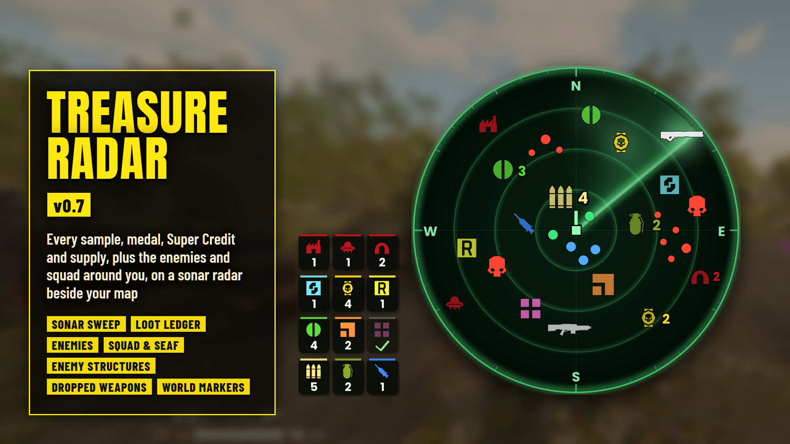

# Treasure Radar

*Every sample, medal, Super Credit, Requisition Slip and supply around you, on a sonar radar where your map opens.*

**Download:** `Treasure-Radar-0.5.0.zip` from the [latest release](https://github.com/Th3chef/Treasure-Radar/releases/latest) (not the source code). Nothing else needed: it has its own loader built in.

A round sonar radar sits where the game's map opens (bottom right) and shows the loot and supplies still lying around you, with a ledger of what's left in the mission and markers floating over the pickups near you. Sweep up the loot and restock before extraction instead of running back and forth looking for it. It's the successor of Treasure Map, rebuilt for the current game.

## Features

- **Sonar radar:** Super Credits, Medals, Common, Rare and Super Samples, Requisition Slips, ammo boxes, grenade packs and stim packs around you, each kind in its own color with the game's own pickup icons. A sweep turns every 3 seconds and each pickup lights up as it passes. North is up, with N, E, S and W on the rim, or the radar turns with you (Rotate With View).
- **Where your map opens:** the radar sits exactly where the game's map opens, so opening the map covers it and nothing else on your HUD moves. It follows your HUD Scale and HUD Edge Offset settings.
- **Loot farther out:** loot beyond the radar's range sits on its edge, pointing the way. Supplies only show inside the range.
- **Piles:** pickups of one kind lying together share one icon, with how many it stands for next to it.
- **Loot ledger (optional):** left of the radar, a pill for each kind, outlined in its color, with how many are still lying in the mission. It counts down as things are picked up, and a cleared kind turns gray with a check mark.
- **World markers (optional):** each pickup near you gets its icon floating over it in the world, with how far it is (25, 50 or 100 m; F8 hides or shows them). Pickups lying together share one marker with a count.
- **Up to date:** a pickup near you that's picked up (by you or anyone else) leaves the radar, the markers and the ledger at once; farther away, within 3 seconds.
- **Zoom:** the numpad's + and - step the radar's range from 50 to 500 m; it remembers the last one.
- **Hide it:** F7, or holding Tab for a moment, hides or shows the radar and the ledger (a tap still just opens the map).
- **Your look:** Opacity (100, 75, 50, 25 or 0%: at 0 only the icons and counts are left), Size (Small, Medium or Large) and the radar's Range (75 to 300 m).
- **Pick what you want:** each kind is its own option.
- **Light and safe:** it only works in missions, lists the pickups every 3 seconds spread over several frames, pauses that while there's nothing to show, and reads the game without changing anything in it.

## Options

In your mod manager (Arsenal / HD2 Mod Manager), on the mod's row:

- **Treasure Radar (core)**: the radar. Keep this ticked.
- **Loot Ledger**: the pills left of the radar with how many of each kind are left.
- **Opacity**: 100% (without it), 75, 50, 25 or 0%: how solid the radar's panel and sweep and the ledger's pills are.
- **Size**: Medium (without it), Small or Large.
- **Rotate With View**: the radar turns with you instead of north up.
- **World Markers**: 50 m (default), 25 m or 100 m.
- **Range**: 150 m (without it), 75, 100, 200, 250 or 300 m.
- **Super Credits** (Super Credit blue), **Medals** (medal yellow), **Common Samples** (green), **Rare Samples** (orange), **Super Samples** (pink), **Requisition Slips** (requisition yellow), **Ammo Boxes** (the game's ammo yellow), **Grenade Packs** (olive green), **Stim Packs** (blue).

**In game:** F7 or hold Tab: hide or show the radar and the ledger. Numpad + / -: zoom the radar. F8: hide or show the world markers.

## Requirements

None. Treasure Radar has its own loader built in.

## Install / update

1. Mod manager (Arsenal / HD2 Mod Manager): add `Treasure-Radar-0.5.0.zip` and enable it, tick Treasure Radar (core), the kinds you want and any options, then **Purge** and **Deploy**.
2. Updating from Treasure Map: disable or remove Treasure Map first (it needs the old loaders, which no longer work on the current game).

## Uninstall

Disable it in your mod manager, then Purge and Deploy. Its files in `%LOCALAPPDATA%` (`treasure_radar.log`, `treasure_radar_state.txt`, `treasure_radar_trace.txt`, `treasure_radar_zoom.txt`) can be deleted.

## Compatibility

- It replaces the game's empty `boot` script (that's how it loads), so it can't be used together with another mod that replaces `boot`, like a stand-alone mod loader. Everything else, HUD mods included, is fine.
- Only you see the radar, the ledger and the markers. Nobody else needs the mod.
- Reads the game only; it never changes anything in it.
- Made and tested on the October 2026 game version (the Lua 5.1 build).

## Known limitations

- Enemy structures and side objectives aren't shown: nothing the mod can read changes when one is destroyed or done, so they would stay on the radar for the whole mission.
- The game's map covers the radar while it's open.
- The radar's spot is measured for HUD Scale 0.75 to 1.25 and any HUD Edge Offset with the default Map Position; with another Map Position it may sit a little off the map.
- Loot shows up once the game has spawned it near you (the list refreshes every 3 seconds).

## How it works

The mod's patch replaces the game's empty `boot` script with its own copy of Chef Loader, a small Lua loader that finds the mod's addon and options in the installed patch files and runs it. Every engine call it makes is guarded: the first time a call is made it leaves a breadcrumb, and if the game ever crashed in it, the next launch skips that call and says so in the log, instead of crashing again. The addon asks the loader for the units of the pickup kinds you picked every 3 seconds (the scan is spread over frames and stops at once when the world changes), works out where each sits relative to your camera, and draws the radar, ledger and markers with the game's own screen drawing, using its own small textures. The radar's spot comes from your HUD settings file.

## Troubleshooting

- Nothing shows: check Treasure Radar (core) and at least one kind are ticked, that you Purged and Deployed, and that no other mod replaces the game's boot script. It only shows in missions.
- The radar sits off the map: tell me your resolution and HUD settings (HUD Scale, HUD Edge Offset, Map Position) with a screenshot with the map open.
- Attach the log to a bug report: *treasure_radar.log* in `%LOCALAPPDATA%` (type %LOCALAPPDATA% into the File Explorer address bar and press Enter). It shows the options you picked, your HUD settings, what it found in each mission and any errors.

## Building from source

See [src/BUILDING.md](src/BUILDING.md).

## Support

If you like my mods, you can support me on [Patreon](https://www.patreon.com/c/Chefboiardee).

## Credits

- The pickup icons are copies of the game's own pickup icons.
- Fonts: Poppins, Anton and Barlow Condensed (SIL Open Font License).

## License

All rights reserved. See [LICENSE](LICENSE).
